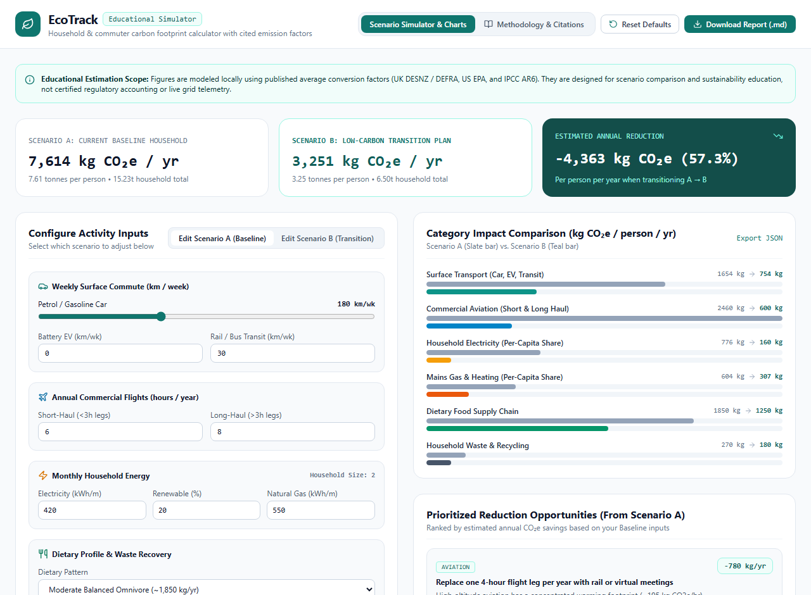
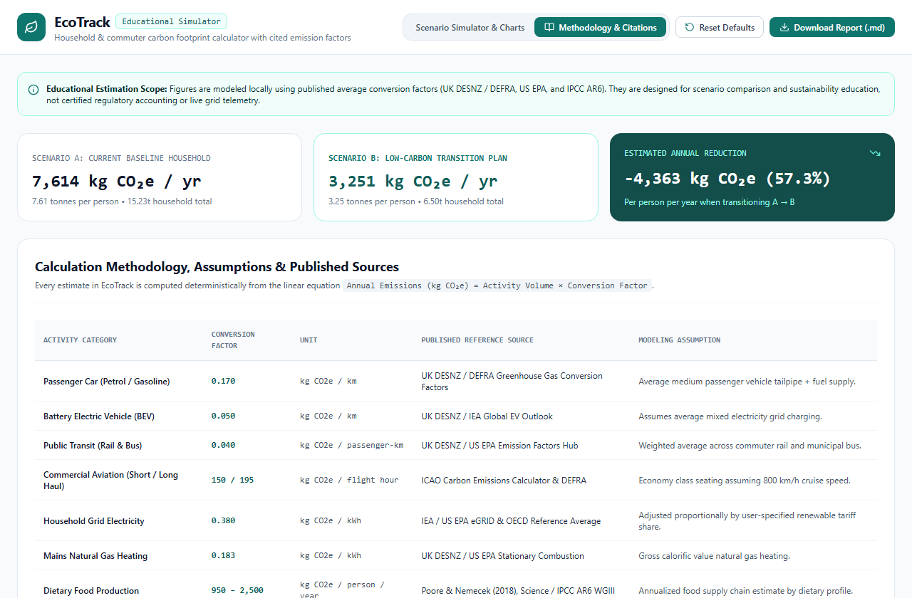
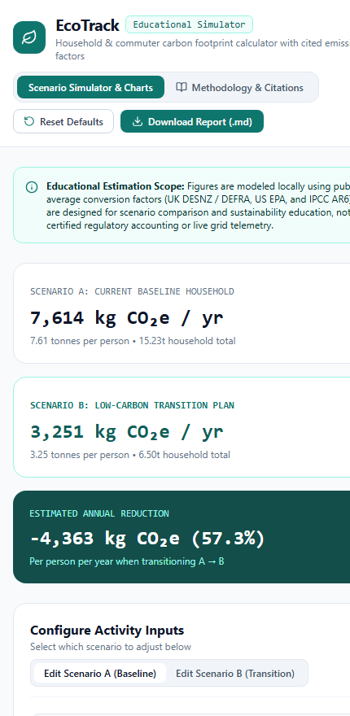

# EcoTrack — Household & Commuter Carbon Footprint Simulator

[](https://opensource.org/licenses/MIT)
[](https://www.typescriptlang.org/)
[](https://react.dev/)
[](https://github.com/iamnarace/ecotrack/actions/workflows/ci.yml)

**EcoTrack** is an educational sustainability dashboard and scenario simulator that models annual household and commuter greenhouse gas emissions (`kg CO₂e / year`), compares baseline habits against low-carbon transition scenarios, highlights prioritized reduction opportunities, and documents every underlying conversion factor and reference source.

---

## Why EcoTrack?

Carbon calculators often act as opaque black boxes that output a single number without explaining the underlying math or letting users compare "what-if" changes side by side.

**EcoTrack** is designed for transparency: it models **Scenario A (Current Baseline)** alongside **Scenario B (Transition Plan)** in real time, ranks practical reduction actions by estimated `kg CO₂e/year` saved, and includes a dedicated **Methodology & Citations** view detailing every emission factor used.

---

## Key Features

- **Side-by-Side Scenario Modeling:** Edit either **Scenario A (Baseline)** or **Scenario B (Transition)** across weekly commuting (`Petrol Car`, `Battery EV`, `Public Transit`), annual short/long-haul flight hours, monthly electricity and renewable tariff share, mains gas heating, dietary pattern, and waste recovery.
- **Category Impact Comparison Charts:** Dual-bar visual comparison across all six emission categories showing exact `kg CO₂e/person/year` shifts.
- **Prioritized Reduction Pathways:** Automatically ranks high-impact reduction opportunities tailored to your current baseline inputs.
- **Published Emission Factor Citations:** Dedicated **Methodology & Citations** tab listing conversion factors, units, and published reference sources (UK DESNZ / DEFRA, US EPA eGRID, ICAO, and Poore & Nemecek 2018 / IPCC AR6 WGIII).
- **Downloadable Reports:** Export your scenario comparison as a clean Markdown report (`.md`) or structured JSON summary (`.json`).

---

## Screenshots

### Desktop — Dual-Scenario Simulator, Category Impact Chart & Reduction Pathways


### Feature View — Calculation Methodology & Published Emission Factor Citations


### Mobile Responsive View
<p align="left">
  
</p>

---

## Technology Stack

- **Framework:** React 18 + TypeScript 5
- **Styling:** Tailwind CSS (Teal, Slate & Amber environmental data visualization theme)
- **Icons:** Lucide React
- **Build & Test:** Vite 6, Vitest 4, React Testing Library, ESLint

---

## Requirements & Installation

- **Node.js:** v20+ LTS recommended (v18.18+ supported for build/runtime)
- **npm:** v9+

```bash
# Clone the repository
git clone https://github.com/iamnarace/ecotrack.git
cd ecotrack

# Install dependencies
npm install
```

---

## Local Development, Build & Testing

```bash
# Start local development server
npm run dev

# Run ESLint static analysis
npm run lint

# Run Vitest unit & component tests
npm test

# Build production bundle
npm run build
```

---

## Calculation Methodology, Regional Presets & Published Sources

EcoTrack computes annual per-capita educational estimates using deterministic linear conversion factors. To avoid silently mixing national grids and vehicle fleets, EcoTrack provides four official **Regional Inventory Presets** for electricity, EV charging, surface transport, and mains natural gas:

| Regional Preset | Geographic Origin | Grid Factor (`kg CO₂e/kWh`) | Petrol Car (`kg/km`) | EV Consumption (`kWh/km`) | Primary Published Source |
| :--- | :--- | :---: | :---: | :---: | :--- |
| **United Kingdom** (`uk`) | UK National Inventory | `0.207` | `0.170` | `0.180` | UK DESNZ / DEFRA GHG Conversion Factors (2024) |
| **United States** (`us`) | US National eGRID & Fleet | `0.352` | `0.190` | `0.195` | US EPA eGRID & GHG Emission Factors Hub (2024) |
| **European Union** (`eu`) | EU-27 Member States Average | `0.210` | `0.164` | `0.175` | European Environment Agency (EEA) & EC JRC (2024) |
| **Australia** (`au`) | Australia NEM & National Inventory | `0.650` | `0.198` | `0.185` | Australian DCCEEW National Greenhouse Accounts (2024) |

- **Consistent EV & Electricity Modeling:** Battery Electric Vehicle (BEV) operational emissions (`kg CO₂e / km`) are calculated dynamically from the selected region's BEV energy consumption (`kWh / km`) multiplied by the scenario's effective electricity emission factor (`renewShare × 0.02 + (1 - renewShare) × regionalGridFactor`). Changing the regional preset or the renewable electricity tariff share updates both household electricity and EV commuting emissions consistently.
- **Global / Transboundary Factors:** Commercial aviation (`150 / 195 kg CO₂e / flight hour`, ICAO Carbon Emissions Calculator) and dietary supply chain profiles (`950 – 2,500 kg CO₂e / person / year`, Poore & Nemecek 2018 / IPCC AR6 WGIII) are explicitly labeled with their international/global meta-analysis origin in the **Methodology & Citations** table.

---

## Project Structure

```text
ecotrack/
├── .github/
│   ├── ISSUE_TEMPLATE/
│   ├── workflows/ci.yml
│   └── pull_request_template.md
├── docs/
│   └── screenshots/
├── src/
│   ├── test/
│   │   ├── carbonEngine.test.tsx
│   │   └── setup.ts
│   ├── utils/
│   │   └── carbonEngine.ts
│   ├── App.tsx
│   ├── index.css
│   └── main.tsx
├── CHANGELOG.md
├── CONTRIBUTING.md
├── LICENSE
├── SECURITY.md
├── package.json
└── vite.config.ts
```

---

## Security, Privacy & Scientific Disclaimer

- **100% Local Processing:** All scenario calculations and report generation happen locally in your browser.
- **Educational Scope & Limitations:** EcoTrack provides educational order-of-magnitude estimates based on published average conversion factors. It does not ingest live smart-meter telemetry, regional real-time grid marginal carbon intensity, or embodied lifecycle emissions of manufactured goods, and is not a substitute for certified ISO 14064 or GHG Protocol corporate audits.

---

## Roadmap

- [x] Regional electricity grid factor presets (EU-27 EEA, US EPA eGRID, Australia DCCEEW NGA, UK DESNZ)
- [ ] Sub-national US eGRID subregion and Australian state (NEM/SWIS) selector
- [ ] Rooftop solar & home battery self-consumption estimator
- [ ] CSV multi-scenario export

---

## Contributing

Contributions are welcome! Please read [CONTRIBUTING.md](./CONTRIBUTING.md) before submitting a pull request.

---

## Acknowledgements

Developed with assistance from Google Antigravity.

---

## License

Licensed under the [MIT License](./LICENSE). Copyright (c) 2026 Naresh Adhikari.
